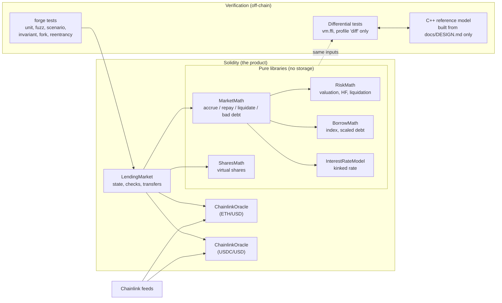

# defi-lending-core

[](https://github.com/Francocaccia/defi-lending-core/actions/workflows/ci.yml)

A minimal **over-collateralized lending protocol** (Solidity + Foundry + Chainlink) whose math is
checked against an **independent C++ reference model**.

> **Educational / portfolio project. Not audited. Never use with real funds.** Runs on mocks,
> local Anvil, mainnet *forks* (read-only) and Sepolia only.
>
> **Status:** milestones M0-M9 are complete: the protocol, its security pass, the demo, the
> independent C++ reference model with its differential tests (written in a separate clean session so that
> it really is independent; see [Reference model](#reference-model)), and a historical risk simulation on six
> years of real Chainlink prices (see [Historical risk simulation](#historical-risk-simulation-m9), including
> what it cannot show).

- **What it is:** a small, security-focused over-collateralized lending protocol (Solidity, Foundry, Chainlink): supply and borrow with a compounding borrow index, oracle-based health factors and liquidations, and bad debt recorded explicitly.
- **What makes it different:** its math is re-implemented independently in C++ (written from the spec only) and differential-tested against the Solidity; line and branch coverage of `src/` is measured at 100%, hand-run mutation checks show the tests catch injected bugs, and a historical risk simulation replays six years of real Chainlink prices (with its limits stated).
- **See it work:** the real output of the demo (supply, borrow, a year of interest, an ETH crash, liquidation, bad debt) is in [`docs/DEMO_OUTPUT.md`](docs/DEMO_OUTPUT.md); run it with `forge script script/Demo.s.sol --sig "runWithInterest()"`.

## What it does

One market, one collateral asset (WETH, 18 decimals) and one borrow/supply asset (USDC-like,
6 decimals):

- **Suppliers** deposit USDC and receive *shares*; interest raises the value of every share
  without any per-user loop.
- **Borrowers** lock WETH, borrow USDC up to **75% LTV**, and accrue interest through a global,
  compounding **borrow index**. They can repay (partially or fully) and withdraw collateral only
  while the position stays inside the LTV limit.
- **Interest rate** is utilization-based with a kink: 0% base, +4% up to 80% utilization, then a
  steep +75% above it.
- **Health factor** `HF = collateralValue x 80% / debtValue`; below 1.0 anyone may **liquidate**:
  repay up to **50%** of the debt and receive collateral worth the repayment **+5%**.
- **Oracles**: one Chainlink feed per asset (the stablecoin is *not* hardcoded at $1). A price that
  is zero, negative, stale, from an incomplete round or from the future makes the call revert.
- **Bad debt** (collateral worth less than the debt) is detected, recorded and written off,
  loss socialized to suppliers. A production system would add an insurance fund first.
- **No admin**: parameters are immutable, there are no privileged functions, no upgradeability.

Parameters above are illustrative defaults chosen at deployment.

## Architecture



The split is deliberate: **the Solidity is the product**; the C++ is an independent check around
it. All protocol math lives in the pure libraries so that the same inputs can be fed to both
implementations. The protocol builds, runs and passes its own tests with **no C++ toolchain**.

```
src/            LendingMarket, ChainlinkOracle, interfaces, libraries/
test/           unit, fuzz, scenario, invariant, fork, security, script, differential
script/         Demo (local story), DeploySepolia (optional), Addresses (verified constants)
docs/           DESIGN (the spec), THREAT_MODEL, ROUNDING_REVIEW, SLITHER_TRIAGE,
                GAS_AND_COVERAGE, M8_HANDOFF, DIFFERENTIAL_REPORT, RISK_SIMULATION
reference-model/  the independent C++ model, its tests and CMake build (milestone M8)
simulator/      the C++ risk simulator, its configs, Chainlink price data and results (milestone M9)
```

## Quick start (no C++ needed)

Requirements: [Foundry](https://book.getfoundry.sh/getting-started/installation) and git.

```bash
git clone --recurse-submodules https://github.com/Francocaccia/defi-lending-core.git
cd defi-lending-core
forge build
forge test
```

`forge test` takes seconds. The fork and differential suites skip themselves automatically, so
this works on a clean machine with no keys and no toolchain. Measured from a fresh clone on the author's
Windows machine (solc already cached): clone with submodules 18 s, `forge build` 21 s, `forge test` 23 s.

**Windows:** the Chainlink dependency contains very deep paths. If `git clone --recurse-submodules` fails
with "Filename too long" (it did when cloned into a deep directory), run `git config --global core.longpaths true`
or clone into a short path such as `C:\src`.

### See it work: the demo

A readable end-to-end story (supply, borrow, a year of interest, ETH crash, liquidation, a deeper
crash and bad debt) on mock tokens and mock price feeds:

```bash
# in-process simulation, also fast-forwards a year to show interest
forge script script/Demo.s.sol --sig "runWithInterest()"

# or with real transactions on a local Anvil node (no time travel: the chain clock is real)
anvil                                   # in another terminal
forge script script/Demo.s.sol --rpc-url http://127.0.0.1:8545 --broadcast --unlocked \
    --sender 0xf39Fd6e51aad88F6F4ce6aB8827279cffFb92266
```

The accounts are Anvil's public development accounts (addresses only, no keys in the repo).
Example output (simulation mode; the full real output, with the exact command and Foundry version, is in
[`docs/DEMO_OUTPUT.md`](docs/DEMO_OUTPUT.md)):

```
== 5. ETH CRASHES from $2,000 to $1,200 (mock oracle updated)
  health factor     0.955223  <- below 1.0: liquidatable
== 6. CAROL liquidates Bob (close factor 50%, bonus 5%)
  carol repaid      5025.000000 USDC of Bob's debt
  carol received    4.396875 WETH
  health factor     1.070447  <- healthy again
== 8. CAROL liquidates again -> all collateral seized, the rest is BAD DEBT
  BAD DEBT recorded 3424.107143 USDC, socialized to suppliers
```

### Optional: mainnet fork tests

These run the real protocol code against the **real** Chainlink ETH/USD and USDC/USD feeds, real
WETH and real USDC. They are read-only (a fork never touches the real chain) and need any free
public mainnet RPC:

```bash
cp .env.example .env                       # set MAINNET_RPC_URL (never commit .env)
forge test --match-path "test/fork/*"
```

### Optional: Sepolia testnet deployment

`script/DeploySepolia.s.sol` deploys the market against the *live Sepolia Chainlink feeds* with
mock tokens, using a **throwaway** testnet key only (set `PRIVATE_KEY` in `.env` to a fresh
wallet funded from a faucet; never a key that has held real funds). It refuses to run on any
other chain. Dry-run first (no `--broadcast`):

```bash
forge script script/DeploySepolia.s.sol --rpc-url $SEPOLIA_RPC_URL                # simulation
forge script script/DeploySepolia.s.sol --rpc-url $SEPOLIA_RPC_URL --broadcast    # for real
# verify each contract on Etherscan (free API key), for example the market:
forge verify-contract <MARKET_ADDRESS> src/LendingMarket.sol:LendingMarket \
    --chain sepolia --etherscan-api-key $ETHERSCAN_API_KEY --watch
```

### Optional: differential tests against the C++ model

```bash
# 1. build the model (see reference-model/README.md), then
FOUNDRY_PROFILE=diff forge test --match-path "test/differential/*"
```

`ffi` is enabled **only** in the `diff` Foundry profile, so a normal `forge test` can never run an
external command. It is safe here because the tests call exactly **one fixed binary built from
this repository** (`reference-model/build/refmodel`) with **numeric arguments only**: no shell, no
network, no user-controlled path or string. The suite skips itself if the binary is missing.

## Design decisions

The full reasoning is in [`docs/DESIGN.md`](docs/DESIGN.md); the highlights:

| Decision | Why |
|---|---|
| **Debt as `scaled x index`**; total debt is *derived* from the exact sum of scaled debts | No drift between the global figure and per-user figures; rounding gap is at most N-1 wei for N borrowers |
| **Round against the user** everywhere (debt up, withdrawals down) | Solvency; every direction is pinned by a test, and flipping any one makes the suite fail |
| **Suppliers earn exactly the increase in derived debt** | Rate rounding can never create a deficit |
| **Virtual shares** (1e6 shares, 1 asset) | Defeats the first-depositor inflation attack |
| **Idle liquidity is an accounting number**, not `balanceOf` | Direct token donations move no price, rate or share ratio |
| **Collateral withdrawals are checked against max LTV**, not the liquidation threshold | A user cannot withdraw into a position any price tick would liquidate |
| **Fail-closed oracle** with per-feed heartbeat; an unusable oracle freezes only borrow / liquidate / debt-backed withdrawals | Repaying, depositing and supplier exits still work during an outage |
| **A liquidation that burns no debt is allowed only if it takes all collateral** | Found by fuzzing: otherwise an extreme price collapse makes bad debt impossible to clear |
| **No admin, immutable parameters** | Nobody can touch user funds; the cost is that a bad deployment cannot be fixed, only redeployed |
| **Reserve factor left out of v1** | Keeps every invariant and the C++ spec simpler; documented as a limitation |

## Testing

| Layer | What it proves |
|---|---|
| Unit + fuzz | exact, hand-computed numbers (cross-checked in Python) and algebraic properties of every pure function |
| Scenario | oracle outages, ETH crash to liquidation to bad debt, bank run, full lifecycle |
| **Invariants** | after random sequences of valid actions: solvency, exact token conservation, debt/share bookkeeping, withdrawals never break max LTV, share price only falls through recorded bad debt |
| **Fork** | works with the real feeds, WETH and USDC (the real USDC price is about $0.9998, not $1) |
| **Reentrancy** | a hostile ERC-777-style token calling back on every transfer cannot re-enter any function; views are already final during callbacks |
| **Demo + vectors** | the demo cannot rot (it is a test); ~1,100 spec vectors from an independent implementation match the Solidity |
| Mutation checks (by hand, at M6; not re-run in the final pass) | injected bugs are caught: 18/18 in the market's unit tests, 11/11 by the invariant suite alone, 8/8 reentrancy guards |
| Static analysis | Slither 0.11.6: 0 findings with the shipped configuration; 39 raw findings if the inline suppressions are removed (41 at the first run, before the `MarketMath` refactor), none a defect ([`docs/SLITHER_TRIAGE.md`](docs/SLITHER_TRIAGE.md)) |

## Reference model

The off-chain model is an **independent C++ re-implementation of the protocol math, written from
`docs/DESIGN.md` only** (its author must not read the Solidity). It exposes the same pure
functions as a command-line program; Foundry feeds random inputs to both and requires identical
outputs and identical failure behaviour. A mismatch is a real finding: either the Solidity or the
spec is wrong.

- **It verifies**: formulas, units and decimals, rounding directions, and the exact overflow /
  divide-by-zero / validation conditions of the pure math (interest, index, shares, valuation,
  health factor, liquidation amounts, bad-debt accounting, parameter validation).
- **It does NOT verify**: the market's state machine, access control, token transfers, reentrancy
  or oracle behaviour. Those are covered by the unit, invariant, fork and security tests.

### What was compared

25 pure functions: the whole interest-rate model, the borrow index, supplier shares, valuation,
health factor, the LTV limit, the liquidation formulas, parameter validation, and the four market
kernels (`accrue`, `repayAmounts`, `liquidationAmounts`, `badDebt`). For each one, Foundry fuzzes
1,000 inputs per run, half of them realistic and half raw 256-bit values (to reach overflow,
division by zero and 10**78), calls the Solidity and the C++ binary through `vm.ffi`, and requires
that either both fail or both return the same words.

**Result at M8:** 0 mismatches. 25,000 fuzz comparisons per run, two runs with different seeds, plus
1,139 shared spec vectors and the worked examples of `docs/DESIGN.md`. The tests are sensitive: an
injected rounding bug in the C++ is caught on the first input, and an injected "evaluate lazily"
bug within a few hundred runs. The full account, including the (non-mismatch) places where
`DESIGN.md` was ambiguous and what the fuzzer does *not* reach, is in
[`docs/DIFFERENTIAL_REPORT.md`](docs/DIFFERENTIAL_REPORT.md).

### Build and run

```bash
cmake -S reference-model -B reference-model/build -DCMAKE_BUILD_TYPE=Release
cmake --build reference-model/build
ctest --test-dir reference-model/build --output-on-failure   # unit + CLI + all vectors
./reference-model/build/refmodel utilization 3 1              # 0x...4a03ce68d215555
FOUNDRY_PROFILE=diff forge test --match-path "test/differential/*"
```

No third-party library is needed (CMake and a C++17 compiler only); see
[`reference-model/README.md`](reference-model/README.md) for the design and the CLI contract.

## Historical risk simulation (M9)

`simulator/` (C++17, links the reference model, so every decision uses the same exact integer math) replays one
borrower position over **every rolling window of the real Chainlink ETH/USD and USDC/USD history from October 2020
to October 2026** (on-chain rounds, committed with their SHA-256) and over 20,000 bootstrapped paths per horizon.
It asks how often a borrower is liquidated and when a liquidation leaves bad debt. Findings with the default
parameters and a position opened at the 75% max LTV (all numbers are in
[`docs/RISK_SIMULATION.md`](docs/RISK_SIMULATION.md), generated from the committed CSVs):

- **Bad debt depends on how fast liquidators act.** It was essentially absent when the liquidator acted within
  hours (0 of 2,111 overlapping 90-day windows at the next hourly observation, 1 at a 1 h delay, 0 at 6 h) and
  appeared in **121 of them (5.73%) with a one-day delay** and 254 (12.03%) with three days. The 0% is the best
  case of a near-instant liquidator, not a safety claim.
- **The margin parameters matter.** A liquidation threshold of 85% (still a valid deployment) left bad debt in 14
  windows (0.66%) even with an immediate liquidator and in 7.44% with a 6 h delay; a 10% bonus, in 2.89% at 6 h;
  a 100% close factor cut the one-day-delay share from 5.73% to 1.28%.
- **The dust gap (threat T22) is large:** with a 25 USD liquidator floor, a 40 USD position was left unliquidated
  while unhealthy in 49.1% of the overlapping 90-day windows, and in 25.8% it was also insolvent.

**Limits, read before quoting any of it.** The sample starts in October 2020: the March 2020 "Black Thursday" crash
and everything earlier are not in it, so the worst known DeFi stress event is outside the evidence. The windows
overlap: 2,111 windows are about 24 non-overlapping 90-day periods (about 6 one-year periods), so "did not occur in
the observed period" is the strongest statement available. It simulates one passive position at fixed utilization
with an idealised liquidator (latency is the only friction), and not late bad-debt recognition (T32). The Python
cross-check is a second implementation written in the same project, not an independent audit: it caught a real
policy difference (lazy against hourly interest accrual) and matches exactly under the same policy, but it cannot
catch a misunderstanding both implementations share. How to run it: [`simulator/README.md`](simulator/README.md).

## Measured metrics

All numbers were reproduced on 2026-10-16 from a fresh clone (Foundry 1.8.5, solc 0.8.28, Windows, MSVC 19.41);
commands and raw output in [`docs/GAS_AND_COVERAGE.md`](docs/GAS_AND_COVERAGE.md) and the sections above.

| Metric | Value |
|---|---|
| Tests, default profile, no RPC (what CI runs): `forge test` | 277 passed, 0 failed, 2 skipped (the fork and differential suites skip themselves) |
| Tests, CI profile (1000 fuzz runs, invariant depth 128): `FOUNDRY_PROFILE=ci forge test` | 277 passed, 0 failed, 2 skipped (48 s) |
| Fork tests (7, real Chainlink feeds, WETH, USDC) | skip without `MAINNET_RPC_URL` (checked with an empty value, as in CI); not re-run in the final pass |
| Differential tests, Solidity vs C++ (`FOUNDRY_PROFILE=diff`, 1000 runs per function) | 31 passed, 0 failed, 0 skipped (30 differential tests + the 1,139-vector test); no mismatch; 916 s |
| Invariant properties | 13, all hold. One 256-run campaign (default profile, depth 64) reached 47 liquidations, 16 bad-debt events, 1,067 borrows and 1,229 collateral withdrawals (328 with debt, 126 rejected by the LTV rule); the totals vary with the random seed |
| Line / statement / branch / function coverage of `src/` (`forge coverage`) | 100% (297/297), 100% (381/381), 100% (61/61), 100% (54/54) |
| C++ reference model tests (`ctest`) | 11/11 |
| Risk simulator tests (`ctest`) | 61 tests, 2,407 checks, 0 failures; the four experiments re-run from a fresh clone give byte-identical CSV and Markdown |
| Slither 0.11.6 | 0 findings with the shipped configuration; 39 without the inline suppressions |
| `LendingMarket` runtime size (`forge build --sizes`) | 9,386 bytes |

Gas per function (median of the unit/scenario tests, fresh storage; see caveats in the docs): `supply`
133k, `borrow` 138k, `repay` 64k, `withdrawCollateral` 66k, `liquidate` 132k.

## Limitations (honest list)

Out of scope for v1, by design:
- Multiple collateral/borrow assets, cross-margin, isolated markets.
- Upgradeable proxies, governance, tokenomics, incentives, a reserve factor / protocol fee.
- Flash loans and flash-loan liquidations.
- Dynamic or governed parameters / interest-rate-model governance.
- **L2 sequencer-uptime checks** (a known gap for L2 deployments).
- A frontend, and a liquidation bot.
- Anything involving real money or a mainnet deployment.

Known risks that remain (details in [`docs/THREAT_MODEL.md`](docs/THREAT_MODEL.md)):
- The Chainlink feeds are trusted. There is no circuit breaker, TWAP or deviation check, so a fresh
  but wrong price (flash crash) is accepted.
- **Bad debt has no first-loss buffer**: suppliers absorb 100% of it. Replaying real prices from October 2020
  shows the exposure is mainly about how fast liquidators act, and that evidence excludes March 2020
  ([`docs/RISK_SIMULATION.md`](docs/RISK_SIMULATION.md)).
- Fee-on-transfer, rebasing and hook tokens are unsupported as the market's own assets; token
  blacklists/pauses (e.g. USDC) are outside the protocol's control.
- Parameters and oracle addresses are immutable: a deployment mistake cannot be fixed.
- Tests are probabilistic and the mutation checks were run by hand; there has been **no external
  audit and no formal verification**.

## Documentation

| Document | Contents |
|---|---|
| [`PLAN.md`](PLAN.md) | milestone status and pending work |
| [`docs/DESIGN.md`](docs/DESIGN.md) | exact math, units and rounding (the spec the C++ model is built from) |
| [`docs/THREAT_MODEL.md`](docs/THREAT_MODEL.md) | threats, defences, evidence, what is NOT mitigated |
| [`docs/ROUNDING_REVIEW.md`](docs/ROUNDING_REVIEW.md) | every rounding decision and the test that pins it |
| [`docs/SLITHER_TRIAGE.md`](docs/SLITHER_TRIAGE.md) | all static-analysis findings, individually judged |
| [`docs/GAS_AND_COVERAGE.md`](docs/GAS_AND_COVERAGE.md) | commands and raw numbers behind the metrics |
| [`docs/M8_HANDOFF.md`](docs/M8_HANDOFF.md) | CLI contract and rules for the independent C++ model |
| [`docs/DIFFERENTIAL_REPORT.md`](docs/DIFFERENTIAL_REPORT.md) | result of the Solidity-vs-C++ comparison, spec ambiguities, limits |
| [`docs/DEMO_OUTPUT.md`](docs/DEMO_OUTPUT.md) | the real output of the local demo, with the exact command and Foundry version |
| [`docs/RISK_SIMULATION.md`](docs/RISK_SIMULATION.md) | liquidation and bad-debt rates on the real price history, parameter sweep, dust gap, validation, limits |
| [`simulator/README.md`](simulator/README.md) | how to build and run the risk simulator, its configs and data |

## License

MIT. See [`LICENSE`](LICENSE).
